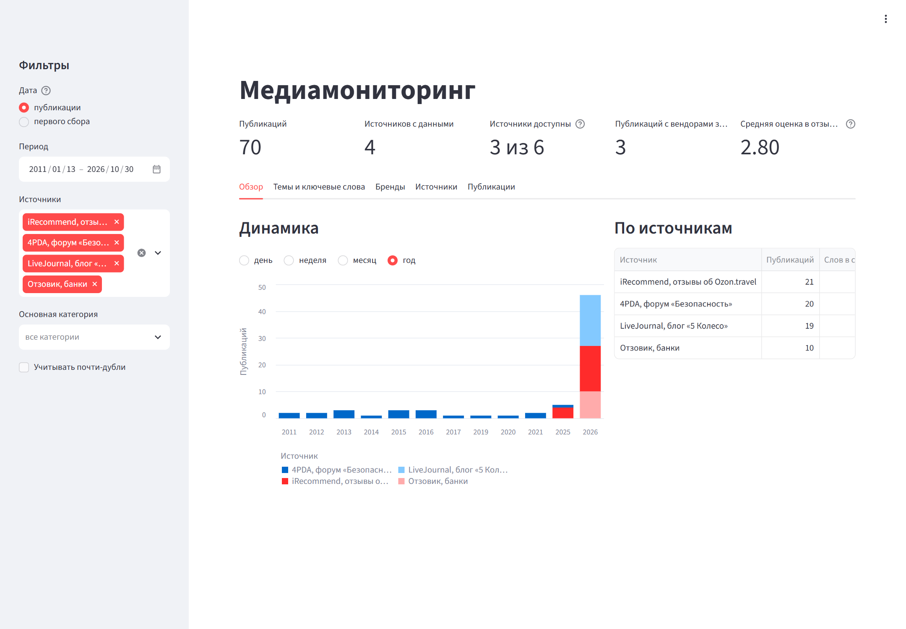
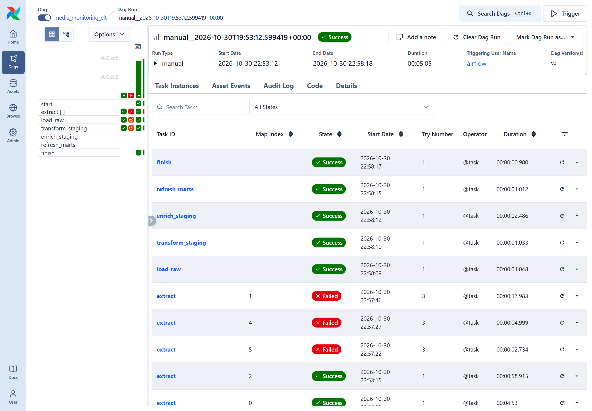
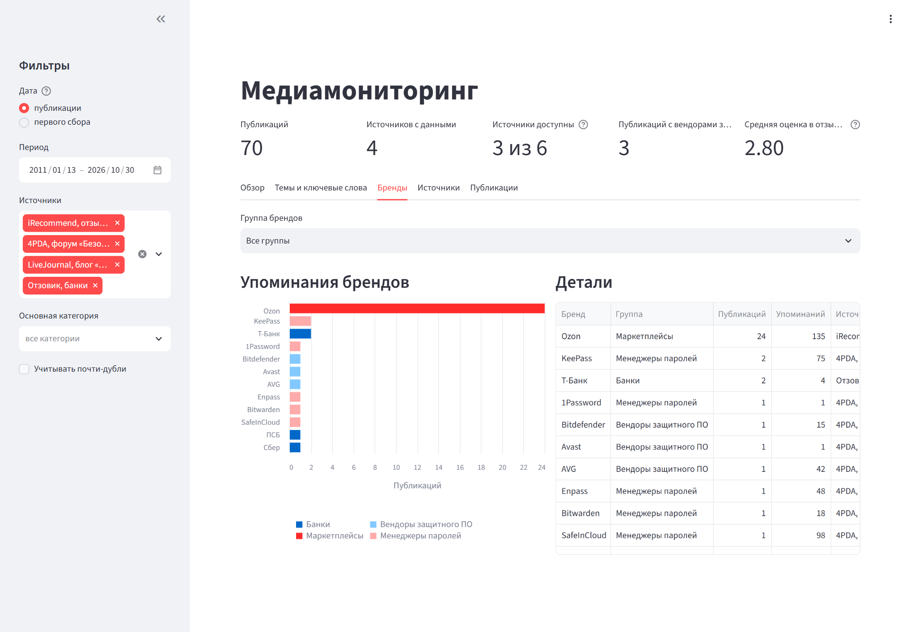
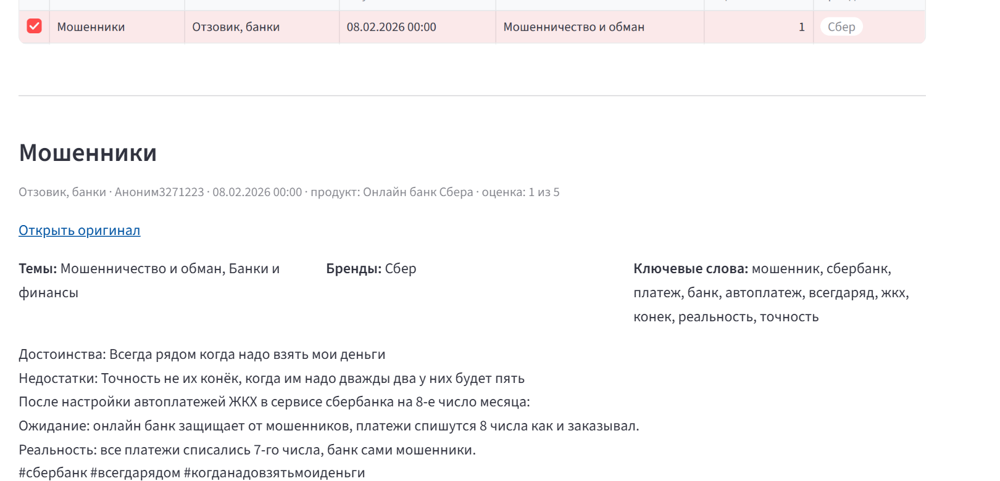

# Media Monitoring ELT Pipeline

Прототип ELT-системы медиамониторинга: сбор публикаций с сайтов разных типов, загрузка в
PostgreSQL, очистка и обогащение текстов, аналитические витрины и дашборд. Оркестрация в
Airflow, всё поднимается в Docker.

Главная идея: источник описывается в [`sources.yaml`](sources.yaml), а не кодом. Один паук
обслуживает блог, форум и сайты отзывов, отличия задаются конфигурацией: где искать ссылки
на публикации, какими селекторами брать поля и в каком порядке доверять Trafilatura и CSS.



## Что реализовано

| Компонент | Где в коде |
|---|---|
| Конфигурация источников и её проверка | [`sources.yaml`](sources.yaml), [`src/config.py`](src/config.py) |
| Один Scrapy-паук для всех источников: обход листингов, пагинация, промежуточные страницы, RSS/sitemap | [`src/extract/spider.py`](src/extract/spider.py), [`src/extract/discovery.py`](src/extract/discovery.py) |
| Извлечение полей с приоритетом методов (Trafilatura / CSS / адаптер), проверка качества | [`src/extract/publication.py`](src/extract/publication.py) |
| Нормализация дат (в том числе «вчера в 14:30»), канонические URL, хэш содержимого | [`src/extract/normalize.py`](src/extract/normalize.py) |
| Миграции схемы и их раннер | [`sql/migrations/`](sql/migrations), [`src/db/migrate.py`](src/db/migrate.py) |
| Идемпотентная загрузка RAW с версиями, трансформация STAGING | [`src/load/postgres.py`](src/load/postgres.py), [`sql/transform/staging_publications.sql`](sql/transform/staging_publications.sql) |
| Обогащение: категории, бренды, ключевые слова, почти-дубли | [`src/transform/enrich.py`](src/transform/enrich.py), [`analytics.yaml`](analytics.yaml) |
| Витрины MART | [`sql/migrations/004_analytics.sql`](sql/migrations/004_analytics.sql) |
| Статусы источников и запусков | [`sql/migrations/003_ops.sql`](sql/migrations/003_ops.sql), [`src/pipeline.py`](src/pipeline.py) |
| DAG Airflow: сбор параллельно по источникам, загрузка, трансформация, обогащение, витрины | [`dags/media_monitoring_elt.py`](dags/media_monitoring_elt.py) |
| Дашборд Streamlit | [`dashboard/app.py`](dashboard/app.py) |
| Тесты (70, офлайн на сохранённых страницах) | [`tests/`](tests) |

## Источники

| Источник | Класс | Состояние |
|---|---|---|
| [LiveJournal, «5 Колесо»](https://5koleso.livejournal.com/) | блог | собирается: посты со страницы блога и следующей страницы |
| [4PDA, раздел «Безопасность»](https://4pda.to/forum/index.php?showforum=320) | форум | собирается: темы раздела, первый пост темы |
| [Отзовик, банки](https://otzovik.com/money_systems/banks/) | отзывы | собирается: каталог → страница банка → отзыв, с продуктом и оценкой |
| [iRecommend, Ozon.travel](https://irecommend.ru/content/sait-ozontravel-0) | отзывы | с 30.10.2026 сайт отвечает HTTP 521; 21 отзыв собран до этого |
| [Дзен Новости, «Компьютеры»](https://dzen.ru/news/rubric/computers) | новостной агрегатор | без JavaScript страница перенаправляет на авторизацию Яндекса, запрещённую robots.txt |
| [Drive2, подборка тем](https://www.drive2.ru/featured-topics/CVQ0gEAAcHQ/) | блог-платформа | robots.txt запрещает обход всем, кроме поисковых систем |

Защита сайтов не обходится. Недоступные источники остаются в конфиге: каждый запуск
проверяет их заново и записывает статус `unavailable` с причиной.

На 30.10.2026 в базе 71 публикация из 4 источников (в RAW 122 версии), 1 найденный почти-дубль,
у 69 из 71 публикаций определена тема. Последний запуск DAG: 3 из 6 источников успешны,
итог `partial_success`.

## Запуск

Нужны Docker и Python 3.12+.

```bash
cp .env.example .env    # задать пароль
docker compose -f compose.yaml -f compose.airflow.yaml -f compose.dashboard.yaml up -d
python -m venv .venv && .venv/Scripts/pip install -r requirements-dev.txt
python -m src.db.migrate
```

- Airflow: http://localhost:8080, DAG `media_monitoring_elt` (запуск вручную).
- Дашборд: http://localhost:8501.

Миграции можно применить и из контейнера: `docker exec media_airflow python -m src.db.migrate`.
База `airflow` для метаданных создаётся скриптом
[`docker/postgres/init/01_airflow_db.sql`](docker/postgres/init/01_airflow_db.sql) при первом
старте Postgres.

Без Airflow:

```bash
python -m src.pipeline --run-id manual_1                                # все источники
python -m src.pipeline --run-id manual_2 --sources livejournal_5koleso  # выбранные
python -m src.extract.spider --source otzovik_banks --run-id debug_1    # только сбор, в файл
```

Тесты:

```bash
pytest
```

## Как устроено

```
sources.yaml ──> PublicationSpider(source_id)
                   поиск ссылок: links | rss | sitemap
                   извлечение: Trafilatura + CSS, порядок для каждого поля
                   дата, хэш, проверка качества
             ──> data/processed/<run_id>/<source>.jsonl + summary.json
             ──> raw.publications        все версии публикаций
             ──> staging.publications    последняя версия
             ──> enrich (analytics.yaml) категории, бренды, ключевые слова, дубли
             ──> mart.*                  витрины
             ──> Streamlit
     ops.source_runs, ops.pipeline_runs  статусы источников и запусков
```

### Добавление источника

```yaml
- id: livejournal_5koleso
  name: LiveJournal, блог «5 Колесо»
  source_type: blog
  start_urls: [https://5koleso.livejournal.com/]
  download_delay: 10                  # Crawl-delay из robots.txt сайта
  max_pages: 2
  discovery:
    mode: links
    area: article.entryunit h3.entryunit__title
    link_pattern: '^https://5koleso\.livejournal\.com/\d+\.html$'
    next_page: .j-page-nav-item-prev a::attr(href)
  selectors:
    title: h1.aentry-post__title
    text: .aentry-post__text
    author: .aentry-head__username .ljuser
    published_at: .aentry-head__date time
  field_priority:                     # Trafilatura не находит автора, дата у неё без времени
    author: [css, trafilatura]
    published_at: [css, trafilatura]
```

Для каждого поля берётся первое значение по приоритету, прошедшее проверку (заголовок не
длиннее 500 символов, текст не короче `min_text_length`, дата разбирается). Откуда взято
поле, записывается в `extraction`. Порядок для каждого источника выбран по сохранённым
страницам: например, на 4PDA Trafilatura берёт не тот пост и заголовок «4PDA», поэтому там
все поля из CSS.

Другие параметры: `follow_pattern` (промежуточные листинги: каталог → страница банка),
`metadata_selectors` (продукт, оценка), `text_cut_markers` и `text_drop_lines` (вырезать
подписи и служебные строки), `block_markers` (признаки капчи), `timezone`, `date_order`.
Если данных нет ни в HTML, ни в метаданных страницы, пишется адаптер в
[`src/extract/adapters/`](src/extract/adapters).

### Данные

- **RAW** хранит версии: ключ `(URL, content_hash)`, загрузка `ON CONFLICT DO NOTHING`.
  Повторная загрузка того же файла ничего не меняет, изменённый текст даёт новую версию.
- **content_hash** считается из канонического URL, заголовка, автора, текста и даты. Время
  сбора, лайки, просмотры, оценка в хэш не входят, поэтому изменение счётчиков не создаёт
  версию.
- **Даты** разбираются в Python (`dateparser`), часовой пояс по умолчанию московский.
  Относительные даты считаются от момента загрузки страницы, исходная строка сохраняется
  в `published_at_raw`. Неразобранная дата даёт `null` и флаг качества, а не ошибку.
- **Качество**: без заголовка, с текстом короче порога или короче заголовка запись не
  попадает в RAW, а сохраняется в `<source>.rejected.jsonl` и учитывается в статистике запуска.
- **STAGING** берёт последнюю версию по URL и обновляет строку только при смене хэша.

### Обогащение и витрины

- **Темы**: словарь в [`analytics.yaml`](analytics.yaml) (защитное ПО, пароли и шифрование,
  слежка и приватность, мошенничество, банки, путешествия, сервис, авто). Текст и термины
  лемматизируются (pymorphy3). Публикация может относиться к нескольким темам.
- **Бренды**: вендоры защитного ПО, менеджеры паролей, банки, маркетплейсы.
- **Ключевые слова**: TF-IDF по леммам, 10 на публикацию.
- **Почти-дубли**: шинглы из 5 слов, порог сходства 0.7. Так найден пост LiveJournal,
  опубликованный дважды с разницей в три недели.
- **Оценка**: только реальная оценка из отзыва, автоматическая тональность не считается.

| Витрина | Содержание |
|---|---|
| `mart.publications` | карточка публикации: источник, даты, текст, темы, бренды, ключевые слова, оценка, признак дубля |
| `mart.daily_publications` | публикации по дню, источнику и теме |
| `mart.category_weekly` | темы по неделям |
| `mart.publication_keywords` | ключевые слова на уровне публикации |
| `mart.brand_mentions` | упоминания брендов с оценкой |
| `mart.source_health` | все источники: последний статус и причина, доля успешных запусков, объём данных |

### Статусы и Airflow

| Статус источника | Когда | Задача `extract` |
|---|---|---|
| `success` | принята хотя бы одна публикация | success |
| `empty` | страницы загрузились, публикаций нет | failed, без повторов |
| `unavailable` | не загрузился листинг или все публикации (HTTP-ошибка, robots.txt, редирект, капча) | failed после повторов |
| `failed` | ошибка в коде паука | failed после повторов |

Ноль публикаций никогда не считается успехом. `extract` запускается отдельной копией на
каждый источник (dynamic task mapping) с повторами и растущей задержкой. Загрузка и
дальнейшие шаги идут, если успешен хотя бы один источник. Итог запуска пишется в
`ops.pipeline_runs`: `success`, `partial_success` или `failed`. Состояния Airflow и
бизнес-статусы не смешиваются: при `partial_success` DAG run зелёный, а недоступные
источники видны красными копиями `extract` и в таблице статусов.



### Дашборд

Фильтры по периоду (по дате публикации или первого сбора), источникам, темам и учёту
дублей. Вкладки: динамика, темы и ключевые слова с тепловой картой «тема × источник»,
бренды, состояние источников с причинами недоступности, список публикаций с поиском и
полным текстом.





## Структура

```
dags/                 DAG Airflow
dashboard/            дашборд Streamlit
docker/               Dockerfile Airflow и дашборда, init-скрипт Postgres
sql/migrations/       схема БД и витрины
sql/transform/        трансформация STAGING
src/extract/          паук, поиск ссылок, извлечение и нормализация
src/load/             загрузка RAW и STAGING
src/transform/        обогащение
src/pipeline.py       шаги пайплайна для DAG и запуска без Airflow
scripts/              разовая перезагрузка старых данных, исследовательские скрипты
tests/                тесты и сохранённые страницы источников
```

## Ограничения

- Темы определяются по словарю: точность зависит от словаря, на текущих данных проверена вручную.
- Поиск дублей попарный, на десятках тысяч публикаций нужен MinHash/LSH.
- На 4PDA собирается шапка темы, ответы в темах нет. Дата публикации у темы - дата её
  создания, поэтому в дашборде есть фильтр по дате первого сбора.
- Пагинация iRecommend не проверена: сайт недоступен с момента подключения к конфигу.
